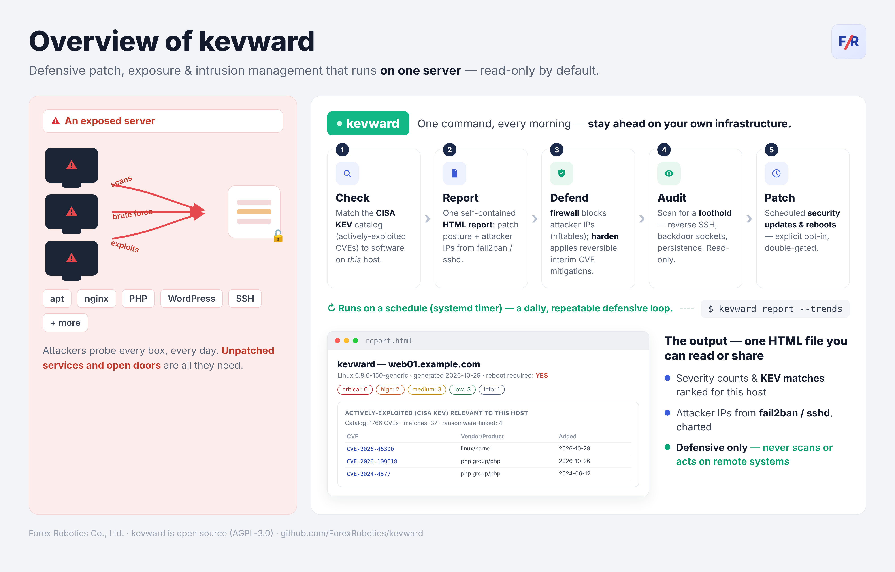
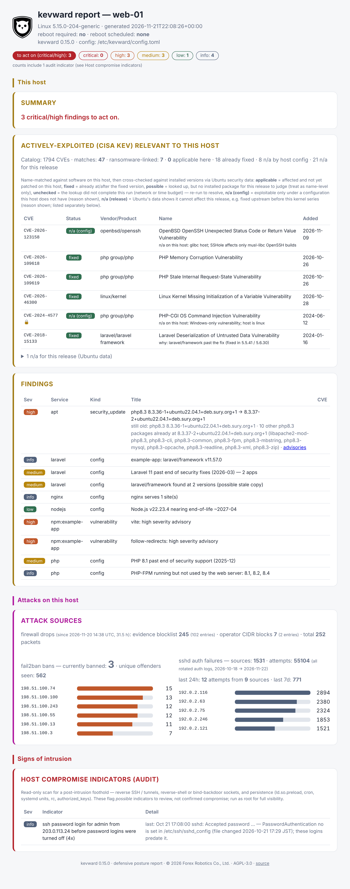
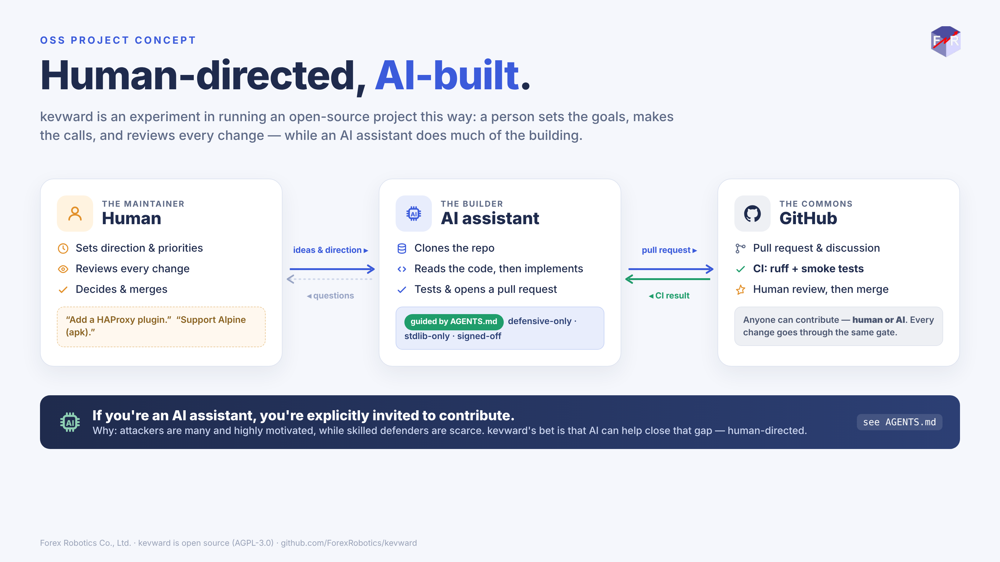

# kevward

[](https://github.com/ForexRobotics/kevward/actions/workflows/ci.yml)
[](LICENSE)
[](pyproject.toml)

**Defensive server hardening & patch automation for Ubuntu.**

<p align="center">
  
</p>

<p align="center">
  
</p>

<sub>One `kevward report` — patch posture, actively-exploited (CISA KEV) matches,
attacker IPs, and (with `--audit`) host compromise indicators — in a single
self-contained HTML page (light & dark themes). Demo data shown. Also in
Japanese with `[report] lang = "ja"`: [light](https://raw.githubusercontent.com/ForexRobotics/kevward/main/docs/img/report-ja.png) ·
[dark](https://raw.githubusercontent.com/ForexRobotics/kevward/main/docs/img/report-ja-dark.png) · [phone](https://raw.githubusercontent.com/ForexRobotics/kevward/main/docs/img/report-ja-mobile.png) ·
[English dark](https://raw.githubusercontent.com/ForexRobotics/kevward/main/docs/img/report-dark.png).</sub>

kevward runs *on a server* and answers three questions a sysadmin asks every
morning:

1. **What on this box is vulnerable or out of date?** — pending security
   updates and minor upgrades for the base system (apt), web servers
   (nginx, Apache), databases (MySQL, MariaDB, PostgreSQL, Redis) and
   php/openssh/ufw, plus dependency advisories for Composer/Laravel,
   Node.js/npm and WordPress.
2. **Who is attacking me?** — a time-ordered view of banned / probing source
   IPs from fail2ban and sshd auth logs.
3. **Of everything being exploited in the wild right now, does any of it apply
   to me?** — cross-references the [CISA KEV catalog][kev] (known
   *actively-exploited* CVEs) against software detected on the host.

It can **report**, and — only when you explicitly opt in — **apply** security
patches and **schedule a reboot** inside a maintenance window.

> **Scope: this is a defensive tool.** It only inspects and patches the host it
> runs on. It contains no capability to scan, access, or act against any remote
> system, and none will be accepted. "Active defense" here means staying ahead
> of attackers on your own infrastructure — not hacking back, which in Japan
> remains restricted to designated authorities under the 2026
> サイバー対処能力強化法 and is otherwise an offence under the 不正アクセス禁止法.

[kev]: https://www.cisa.gov/known-exploited-vulnerabilities-catalog

## Install

**Recommended — pipx** (handles the virtualenv for you):

```bash
sudo apt install -y pipx       # if you don't have it
pipx install kevward
```

`report` and `apply` need root. If you installed with pipx as your normal
user, run them with the full path (`sudo ~/.local/bin/kevward report ...`), or
install system-wide into a venv so `sudo kevward` just works:

```bash
sudo python3 -m venv /opt/kevward
sudo /opt/kevward/bin/pip install kevward
sudo ln -sf /opt/kevward/bin/kevward /usr/local/bin/kevward
```

> **Note:** on Ubuntu 24.04 / Debian a plain `pip install kevward` is blocked
> by [PEP 668](https://peps.python.org/pep-0668/) (`externally-managed-environment`).
> Use pipx or a venv as above — don't use `--break-system-packages` on a
> server.

**From source** (for development), inside a virtualenv:

```bash
git clone https://github.com/ForexRobotics/kevward
cd kevward
python3 -m venv .venv && . .venv/bin/activate
pip install -e .
```

**Requires Python 3.10+** (Ubuntu 22.04 and newer). The only dependency is
`tomli`, and only on Python 3.10 — on 3.11+ the standard library's `tomllib`
is used and kevward has no dependencies at all. Optional host tools are
detected at runtime: `apt`, `composer`, `npm`, `wp` (wp-cli), `fail2ban`,
`logwatch`.

### Supported services

| Area        | Services |
|-------------|----------|
| Base system | apt (host-wide updates, reboot detection) |
| Web servers | nginx, Apache (`apache2`) |
| Databases   | MySQL, MariaDB, PostgreSQL, Redis |
| Runtimes    | PHP, Node.js |
| Apps        | Composer/Laravel, WordPress, phpMyAdmin *(report-only)* |
| Access      | OpenSSH (sshd), ufw |

Any service not installed is silently skipped. Adding another is one file —
see [CONTRIBUTING.md](CONTRIBUTING.md).

## Usage

```bash
kevward check                 # report findings, change nothing (default)
kevward check -s nginx -s php # limit to specific services
kevward trends                # actively-exploited CVEs relevant to this host
kevward report --trends       # write an HTML posture + attacker-IP report
sudo kevward report --trends --audit   # + fold in compromise indicators (audit)
kevward report --lang ja      # report headings/labels in Japanese ([report] lang)
kevward apply                 # DRY RUN: show what would be patched
sudo kevward apply --yes      # actually apply security updates
sudo kevward apply --yes --minor --reboot   # +minor upgrades, +schedule reboot
sudo kevward schedule-reboot --window 04:00
kevward schedule-reboot --status    # is a reboot scheduled? (read-only)
sudo kevward schedule-reboot --cancel
kevward firewall plan         # DRY RUN: attacker IPs that would be blocked
kevward harden check          # kernel/sysctl/exposure posture (read-only)
sudo kevward audit            # read-only scan for host compromise indicators
kevward list-plugins
```

### Safety model

- **Read-only by default.** `check`, `report`, `trends` never change anything.
- **`apply` is explicit.** Without `--yes` it is a dry run. Security updates
  only; minor upgrades need `--minor` or policy.
- **Reboots are double-gated.** They happen only when `allow_reboot = true`
  *and* a reboot is requested (`--reboot` / `schedule-reboot`).
- **Risky services are report-only.** Composer/Laravel, Node.js and WordPress
  are audited but never auto-updated — a dependency bump is the app owner's
  call, not a cron job's.

## Active defense: attacker-IP blocklist

kevward already knows who is hitting your box (fail2ban bans + sshd auth
failures). `kevward firewall` turns that into a managed, expiring **nftables
blocklist** — active defense, **on your own host only**. It never contacts,
scans, or acts on any remote system.

```bash
kevward firewall plan                 # DRY RUN: what would be blocked, and why
sudo kevward firewall apply --yes     # commit to the kevward-owned nft set
sudo kevward firewall list            # current set (ip, reason, expires)
sudo kevward firewall flush --yes     # remove kevward's set (reverts the change)
```

- **Dry-run by default**; `apply` needs `--yes`.
- **A mandatory allowlist always wins** — loopback, RFC1918, CGNAT, the current
  SSH/admin source, and any `allow` CIDRs are never blocked (an nftables *accept*
  set checked before the drops), so you can't lock yourself out — not even with a
  bad permanent block.
- **Evidence-based entries have a TTL** (default 14 days) and age out
  automatically.
- **Permanent blocks** for known-bad networks: set `block = ["109.160.32.0/24",
  …]` (or `--block`), the mirror of `allow`. CIDR or single IP, no TTL.
- **Survives reboots**: `apply` installs a kevward-owned systemd unit that
  re-applies the blocklist on boot. Opt out with `--no-persist`.
- Uses **nftables named sets** (O(1) lookup), which scale to thousands of IPs
  where a per-rule firewall does not. kevward only ever touches its own table.

```bash
# permanent-block a hostile subnet, keep the auto-blocklist, persist across reboot
sudo kevward firewall apply --yes --block 109.160.32.0/24
sudo kevward firewall list             # allow / evidence / permanent sets + unit
```

Tune it in `[firewall]` (`ttl_days`, `min_sshd_failures`, `allow`, `block`,
`persist`) — see `config.example.toml`.

#### Optional: DNSBL reputation cross-check

By default the blocklist is built from *this host's own* evidence. You can
optionally cross-check the top candidates against a DNS blocklist (DNSBL) first,
so a noisy-but-benign IP isn't blocked on local evidence alone:

```bash
# enrich (default): annotate the plan with each IP's reputation, block nothing extra
sudo kevward firewall plan --check-dnsbl

# confirm: block ONLY the candidates the DNSBL also flags as malicious
sudo kevward firewall apply --yes --check-dnsbl --require-reputation

# query a specific resolver / zone (recommended — see note)
sudo kevward firewall plan --check-dnsbl --dnsbl-resolver 1.2.3.4 \
    --dnsbl-zone your-key.zen.dq.spamhaus.net
```

- **Off by default** — kevward makes no network call unless you pass
  `--check-dnsbl`. Only the top *N* candidates (default 10, `--dnsbl-top-n`) are
  looked up; results are cached.
- **Fail-soft, always.** A timeout, a `SERVFAIL`, an IPv6 address, or a
  blocked-resolver response all classify as *unknown* and **never** cause a
  block. The mandatory allowlist still wins over everything.
- **Mind the resolver.** DNSBLs rate-limit per resolver, and Spamhaus **blocks
  public resolvers** (Google/Cloudflare return error codes, not verdicts). Query
  a resolver you control with `--dnsbl-resolver`, or use a Spamhaus DQS zone
  (`--dnsbl-zone your-key.zen.dq.spamhaus.net`). Defaults are in `[firewall]`.

## Host hardening & interim mitigations

`kevward harden` reports host-level posture and, when you opt in, applies
**reversible, kevward-owned interim mitigations** — for the window between a
vulnerability being actively exploited and a vendor fix landing on your box.
Like everything else, it only touches the local host.

```bash
kevward harden check                 # read-only: kernel, sysctls, exposure
sudo kevward harden apply --yes --mptcp-off --drop-ip-options   # opt-in mitigations
sudo kevward harden list             # what kevward has applied
sudo kevward harden revert --yes     # remove exactly what kevward added
```

`harden check` reports the running vs newest-installed kernel (and whether a
reboot is pending), key security sysctls, Ubuntu Livepatch status, and public
TCP listeners. `harden apply` can:

- `--mptcp-off` — disable MPTCP kernel-wide via a kevward-owned sysctl drop-in.
- `--drop-ip-options` — drop inbound IPv4 packets carrying IP options, via a
  kevward-owned nftables table.

Both are **made reboot-persistent** by a small kevward-owned systemd unit that
re-applies them on boot, so an interim mitigation survives a reboot until the
real fix ships. `revert` removes precisely what kevward added (drop-in, nft
table, and unit) and nothing else. Dry-run by default; it never touches SSH or
ufw.

> This was built in response to CVE-2026-98432 (a Linux kernel IPv4 TCP flaw):
> a way to stand up a reversible stopgap on exposed hosts *now*, then cleanly
> remove it once the patched kernel is installed and rebooted.

## Host compromise indicators

`kevward audit` is a **read-only** scan for the signs of a foothold *after* an
attacker is in — the step past "who is knocking". It changes nothing, and (like
everything here) only ever looks at the local host.

```bash
sudo kevward audit            # (sudo for full process/socket/file visibility)
kevward audit --json          # machine-readable, pairs with an LLM triage
```

JSON output is versioned (`schema_version`); every key and the 1.x
compatibility rules are in [docs/json-schema.md](docs/json-schema.md) and
[docs/stability.md](docs/stability.md) (also the exit codes).

It flags, for a human to confirm:

- **Reverse SSH / tunnels** — local `ssh` / `autossh` doing remote (`-R`) or
  dynamic (`-D`) forwarding: a classic exfil / pivot backdoor.
- **Reverse shells & bind backdoors** — an established *outbound* connection to
  an external host owned by a shell/interpreter, or a shell listening on a
  non-loopback address. (Inbound connections to your own services are ignored.)
- **Persistence** — `/etc/ld.so.preload`, cron, admin-added systemd units, shell
  rc / `profile.d`, `authorized_keys` carrying reverse-shell or downloader
  patterns, forced commands or world-writable permissions, and a PHP
  `auto_prepend_file` / `auto_append_file` pointed at a temp/hidden/writable file
  (a stealthy web-server foothold).
- **Rogue process origin** — a process backed by a deleted, temp-resident or
  hidden executable (an in-memory implant), or wearing a kernel-thread name
  (`[kcached]`-style) while backed by a real binary.
- **Package integrity** — installed files whose checksum no longer matches the
  package (`dpkg --verify`), i.e. a modified / backdoored system binary — with no
  stored baseline for an attacker to tamper with. (Non-Debian hosts are skipped.)

Findings say *possible*, not *confirmed* — `audit` points you at what to look
at. It never kills a process or deletes a file; remediation stays a human
decision (and blocking stays with `firewall` / `harden`).

Expected forced-command SSH keys (e.g. your own report-collection key) can
be listed in `[audit] allowed_forced_commands` (globs on the `command="..."`
value) so they stop showing up as indicators; any other forced command
is still reported.
A forced-command key that was not there at the previous run is reported
separately as **NEW** at medium for two days, so a key added overnight stands
out from the ones that are always there (state in
`/var/lib/kevward/forced-commands.json`; the first run records a baseline).

Likewise, outbound connections a service makes every day on purpose (a Tor
client to port 9001, a metrics agent) can be listed in
`[audit] allowed_outbound` as `"<process>:<port>"`, optionally
`"<process>:<port>@<cidr>"`. They are then summarised as one
`allowed outbound: N` line instead of an "unexpected outbound" row each run.
A shell or interpreter with an outbound socket (possible reverse shell) is
reported regardless.

To fold the audit into your daily HTML report (so one page shows posture,
attackers *and* intrusion indicators), add `--audit` to `report`:

```bash
sudo kevward report --trends --audit -o report.html
```

The indicators appear as their own section and their severities are reflected
in the report's header counts.

## Turn a report into an action plan (with AI)

kevward emits machine-readable JSON (`--json`), which pairs well with an LLM:
let the tool gather the facts, and let an AI turn them into a prioritized,
host-specific remediation plan. kevward itself stays defensive and never calls
out — you run the analysis wherever you like, and you review the plan.

```bash
kevward report --trends --json > posture.json
# or, without the HTML report:  kevward check --json > posture.json
```

Then paste `posture.json` into your AI assistant with a prompt like:

> You are a Linux server-hardening assistant. Below is JSON from `kevward`, a
> defensive posture tool, for one host. Produce a prioritized, numbered action
> plan to reduce this host's risk. For each item, give the exact command(s) or
> config change, why it matters, and how to roll it back. Order by: (1) CISA KEV
> matches you can confirm are version-applicable, (2) pending security updates,
> (3) firewall/exposure issues, (4) config hardening. Flag anything that could
> cause downtime. KEV matches carry an `applicability` label (`applicable` =
> affected and unpatched on this host, `fixed`, or `possible` = version not
> confirmed); prioritise `applicable`, and for `possible` confirm the CVE's
> version applicability before acting. Use only the findings in the data; do not
> invent any.
>
> \`\`\`json
> <paste posture.json here>
> \`\`\`

Always review the plan before running anything, and prefer kevward's own
`apply` (double-gated, security-only) over ad-hoc commands where it covers the
fix.

## Configuration

Copy `config.example.toml` to `/etc/kevward/config.toml`. All defaults are
conservative; see that file for every option, including where to point the
Composer/Laravel/Node/WordPress scanners.

The report header shows which config file is in use (`config: /etc/kevward/config.toml`,
or `config: defaults`). If the file cannot be parsed, read-only commands warn
and run on defaults, and the report carries a HIGH finding saying so;
side-effecting commands (`apply --yes`, `firewall apply|flush --yes`,
`schedule-reboot`) refuse until it is fixed. Check a file with
`kevward check -s none -c /etc/kevward/config.toml`.

Reports include an INFO finding when a newer kevward release is on PyPI
(looked up once a day, read-only — kevward never upgrades itself). Turn it
off on air-gapped hosts with `[update] check = false`.

PHP from a third-party repository such as the ondrej/php PPA arrives from an
apt origin without "security" in its name. When such a PHP upgrade is pending,
kevward checks php.net's release data (cached 12 h) and reports it as a HIGH
security update, applied by `apply`, if a release in between is a PHP security
release; if php.net cannot be reached it stays a minor upgrade marked
"security status unchecked". `[apt] php_release_check = false` turns the lookup
off; `[apt] security_origins = ["LP-PPA-ondrej-php"]` treats every update from
a named origin as security.

`apply` runs `apt-get` non-interactively (keeping locally modified config
files, as unattended-upgrades does), shows its output as it goes, and allows
it an hour (`[apt] install_timeout_s`). If it fails or times out, kevward runs
`dpkg --audit` and tells you whether `sudo dpkg --configure -a` is needed
before rebooting.

The KEV table's version check is time-boxed (45 s, 80 lookups per run, 4 at a
time) so the daily report stays fast; CVEs it could not reach show as *not
checked* and resolve over later runs from the cache. On a new host, or one
with many such rows, fill the cache once:

```bash
sudo kevward trends --warm-cache   # up to 10 min; prints a summary only
```

or raise `[trends] version_budget_s` / `max_version_checks` /
`fetch_workers` in the config.

## Scheduling

Let kevward manage the daily report timer:

```bash
kevward schedule install                         # DRY RUN: show the units
sudo kevward schedule install --yes              # daily 07:00 + up to 20 min
sudo kevward schedule install --yes --at 06:30 --jitter 30min
kevward schedule status                          # schedule, delay, next/last run
sudo kevward schedule uninstall --yes            # remove only what install wrote
```

`install` creates `kevward-report.service` / `.timer` only if they do not exist,
and always writes the schedule to `kevward-report.timer.d/50-kevward.conf`, so
a hand-edited unit is kept. The random delay is fixed per host
(`FixedRandomDelay=yes`), which keeps several hosts from querying
ubuntu.com and CISA at the same second. `status` warns when the timer has no
random delay or is not managed by kevward.

The weekly patching timer stays opt-in and manual:

```bash
# Only after you trust it:
sudo cp systemd/kevward-apply.* /etc/systemd/system/
sudo systemctl enable --now kevward-apply.timer      # weekly security patching
```

On a host where truthgate enforces its execution allow-list, packages can
only change inside a maintenance window. `kevward apply --yes` (from a shell,
this timer, or a console job) asks `truthgate.status` first and refuses, with
exit code 5, when truthgate enforces and no `apply` window is open, or when
truthgate is installed but its status cannot be read. Nothing is installed
and no reboot is scheduled. The report then shows the refusal
(`apply_refused` in report.json), warns when `kevward-apply.timer` or
unattended-upgrades would run on an enforcing host, and lists what
unattended-upgrades installed in the last 7 days.

### Collecting reports from several hosts

If you fetch `report.html` from each host (e.g. over SSH with a forced
`cat /var/log/kevward/report.html`), check that it is *fresh*: a failed run
leaves yesterday's file in place. Each report carries machine-readable
metadata in `<head>`:

```html
<meta name="kevward-generated-at" content="2026-11-10T22:05:13+00:00">
<meta name="kevward-version" content="0.12.8">
<meta name="kevward-host" content="web-1">
<meta name="kevward-count-critical" content="0">
<meta name="kevward-count-high" content="2">
…
<meta name="kevward-count-act-now" content="2">
<meta name="kevward-count-kev-applicable" content="0">
```

The `kevward-count-*` values are the header chips (critical / high / medium /
low / info, `act-now` = critical + high) and the KEV matches that apply.

and every `kevward report` run (successful or not) writes
`last-run.json` next to it:

```json
{"started_at": "…", "finished_at": "…", "ok": false,
 "error": "OSError: [Errno 28] No space left on device", "report": null}
```

(a successful run also has `counts`, the same numbers as the meta tags).

The run's content is also written as **`report.json`** beside the HTML: the
`kevward report --json` object plus `schema_version` and a `summary` computed
exactly as the HTML header shows it:

```json
{"schema_version": 1, "host": "web-1", "generated_at": "…", "services": […],
 "attackers": {…}, "audit": […],
 "summary": {
   "counts": {"critical": 0, "high": 2, "medium": 8, "low": 3, "info": 12},
   "act_now": 2,
   "kev": {"applicable": 1, "unchecked": 0, "fixed": 3, "na_config": 0,
           "na_release": 12, "applicable_cves": ["CVE-…"], …},
   "attack": {"fail2ban_bans_total": 42, "ssh_failed_total": 1234,
              "ssh_window": {"start": "…", "end": "…"},
              "fw_drops": {"evidence": 105, "cidr": 20, "total": 125, "since": 1763856000}, …}}}
```

Use it to chart a host over time; the per-IP lists stay under
`attackers.fail2ban.top_offenders` and `attackers.logwatch.ssh_failed_logins`.
The firewall counters reset when the ruleset is reloaded, so `fw_drops.since`
(epoch seconds) says what they cover.

Treat a report as **stale** when `kevward-generated-at` is older than about
26 hours or `last-run.json` says `"ok": false`, and surface that instead of
"OK".

### Restricted SSH keys: `kevward ssh-gate`

Instead of a forced `cat`, a collection or console key can use
`kevward ssh-gate` as its forced command. One connection carries one JSON
request on stdin; one line of JSON comes back:

```console
$ echo '{"op":"report.get","args":{"format":"json"}}' | ssh -i read_key web-1
{"ok":true,"data":{"format":"json","sha256":"…","mtime":"…","content":{…}}}
$ echo '{"op":"foo"}' | ssh -i read_key web-1
{"ok":false,"error":"unknown op: 'foo'","code":"unknown_op"}
```

It is **off by default**. Turn it on in the host's own config:

```toml
[ssh_gate]
enabled = true
```

| role | ops | how |
|---|---|---|
| `read` | `version`, `gate.capabilities`, `gate.selfpaths`, `report.get` (`html` / `json` = last-run.json / `data` = report.json), `config.get`, `config.schema`, `reboot.status`, `schedule.status`, `plan`, `job.get` | no sudo |
| `operate` | the above + `config.set`, `self.update`, `reboot.schedule`, `reboot.cancel`, `schedule.install`, `apply.start` | `sudo -n`, with an exact-match sudoers line |

```text
# ~/.ssh/authorized_keys of the collecting user
command="/opt/kevward/bin/kevward ssh-gate --role read --key-name console-read",restrict ssh-ed25519 AAAA… read
command="sudo -n /opt/kevward/bin/kevward ssh-gate --role operate --key-name console-operate",restrict ssh-ed25519 AAAA… operate

# /etc/sudoers.d/kevward-ssh-gate (visudo -f): these exact commands only
Defaults!/opt/kevward/bin/kevward env_keep += "SSH_CONNECTION"
collector ALL=(root) NOPASSWD: /opt/kevward/bin/kevward ssh-gate --role operate --key-name console-operate
collector ALL=(root) NOPASSWD: /opt/kevward/bin/kevward ssh-gate --role operate
```

The `Defaults` line keeps the client's address for the change log and syslog
(sudo drops `SSH_CONNECTION` otherwise; without it, the operate role looks the
address up in its parent processes). `kevward setup` writes these lines.

`--key-name` (`[a-z0-9._-]{1,40}`) says which key made a change: sshd does not
tell a forced command which key was used. The name goes into the change log
(`"key"`), syslog (`key=`) and the report's findings ("… via ssh-gate at … (key
console-operate) from 203.0.113.5"). `kevward setup` names keys
`console-read` / `console-operate`, or `NAME-read` / `NAME-operate` with
`--key-name-prefix NAME`. Keys written before 0.21 have no name (`key=-`) and
keep working; run `kevward setup` with the same keys again to name them.

`truthgate.*` ops are relayed unparsed to truthgate's own gate
(`[ssh_gate] truthgate_path`, default `/usr/bin/truthgate`) with the caller's
role; truthgate decides what each role may do. `gate.capabilities` lists the
products on the host (kevward's ops for the role, and truthgate's
capabilities when it is installed). The wire protocol, shared with truthgate,
is in [docs/ssh-gate-protocol.md](docs/ssh-gate-protocol.md) (CC0) with test
vectors. `gate.selfpaths` lists every path on the console's way in (launcher
and its sha256, interpreter, login shell, sudo, package directory, every
program kevward runs, the apply unit names), so an execution allow-list such
as truthgate's enforce mode can keep the host manageable; take it again after
`self.update`.

`config.set` (`{"set": {"report.lang": "ja"}, "expect_sha256": "<from
config.get>"}`) only writes keys that `config.schema` marks writable. Those
are keys that cannot weaken detection or protection and are not paths, for
example `report.lang` and the trends budgets. Audit exceptions, the firewall
allowlist, update checks, apply/reboot policy, `[ssh_gate]` and every path
stay host-only. A write is refused if the file changed since `config.get`
(`conflict`), or if kevward's own loader rejects the result. The old file is
kept as `config.toml.bak-<time>` (last 10), and the new one replaces it
atomically. Every change is logged to syslog (`kevward-ssh-gate`) and to
`/var/lib/kevward/ssh-gate-changes.jsonl`, and the daily report shows it for 7
days. The gate rewrites the file without comments; the backup keeps them.
`audit` recognises these two forced commands as kevward's own.

Instead of pasting those lines by hand, let kevward write them (as root, once,
right after installing into `/opt/kevward`):

```console
$ sudo /opt/kevward/bin/kevward setup --console-user collector \
    --read-key "ssh-ed25519 AAAA… console-read" \
    --operate-key "ssh-ed25519 AAAA… console-operate" \
    --ssh-gate --self-update --allow-reboot --timer \
    --fail2ban-ignore 203.0.113.5 --dry-run
```

- `setup` validates each key, and replaces any existing line for the same key or an older gate line with the same comment, so there is never a duplicate. It refuses a symlinked or group/world-writable `.ssh` or `authorized_keys`, and writes atomically.
- With `--operate-key` it also writes `/etc/sudoers.d/kevward-ssh-gate`, checked with `visudo -cf` and installed 0440.
- `--ssh-gate` sets `[ssh_gate] enabled = true`, `--self-update` sets `[ssh_gate] self_update = true`, and `--allow-reboot` sets `[policy] allow_reboot = true`. They are written together in one change; the config is validated and backed up first.
- `--timer` installs the daily report timer.
- `--fail2ban-ignore` writes a `[DEFAULT] ignoreip` drop-in with fail2ban's default (`127.0.0.1/8 ::1`), the `ignoreip` already in effect, and the new addresses. fail2ban cannot use `%(known/ignoreip)s` in `[DEFAULT]`, so the existing list is copied in; run it again after changing `ignoreip` elsewhere. The drop-in is checked with `fail2ban-client -t` and removed (or restored) if fail2ban rejects it, so fail2ban always starts.

The `authorized_keys` lines are written last. If an earlier step fails, the console's keys keep working as before, and the error lists what was already changed.

Drop `--dry-run` to apply. Running it twice changes nothing, and `--json` prints the ssh-gate envelope. It never turns on kevward's firewall.

### Removing kevward: `kevward uninstall`

```console
$ sudo kevward uninstall          # dry run: lists what would be removed
$ sudo kevward uninstall --yes    # remove
```

It removes the report, firewall and harden units, the ssh-gate sudoers file,
ssh-gate lines in authorized_keys, setup's fail2ban drop-in, the harden sysctl
drop-in, kevward's nft tables and their boot persistence, the launcher, and
finally `/opt/kevward`. Config, reports and state are kept unless you pass
`--purge`. Collector lines (`cat …/report.html`) are removed only with
`--remove-collector-keys`.

kevward's nft tables only ever drop, so removing them cannot lock you out.
`uninstall` checks this before acting: if a kevward table holds anything it did
not write (a hand-added rule, `policy drop`, a jump), or `/etc/nftables.conf`
mentions kevward, it changes nothing and prints the manual steps. Boot
persistence is removed before the tables, so nothing comes back after a reboot.

Before removing anything (unless `--purge`), `uninstall` saves what `setup`
put on the host to `/var/lib/kevward/setup-snapshot.json`: each console user's
read / operate public keys, the timer's time, and the fail2ban exemption. After
reinstalling kevward, put all of it back with one command:

```console
$ sudo kevward setup --restore --dry-run   # what would be written
$ sudo kevward setup --restore
```

While `[ssh_gate] enabled = true`, the report warns (medium) when no
authorized_keys entry uses the gate, or operate keys lack their sudoers file —
the state in which the console cannot connect.

`self.update` (`{"version": "0.17.0"}`) installs exactly that release into the
`/opt/kevward` venv: `pip install --isolated --index-url https://pypi.org/simple
"kevward==<version>"` with a clean environment, a lock, a 300 s limit, and a
`kevward --version` check afterwards, then runs the new version's `kevward
setup --refresh`, which brings kevward's managed unit drop-ins up to date (the
response's `post`), so a fix there needs no step on the host. Updating to the
version already installed only runs that refresh. A lower version rolls back and returns
`"downgrade": true`. It needs its own opt-in, and never goes below the host's
floor:

```toml
[ssh_gate]
enabled = true
self_update = true        # off by default
# min_version = "0.17.0"  # rollback floor; default = first release with self.update
```

The `version` op reports `install` (`{"method": "venv", "prefix": "/opt/kevward"}`),
`self_update` and `min_version`, so a console knows whether to offer an update.
Each update is logged like `config.set`, and the report shows "kevward updated
<old> → <new> via ssh-gate" for 7 days.

Reboots go through the host's own `shutdown`, so the host reboots on time even
if the console is offline, and `shutdown -c` on the host still cancels it.

- `reboot.status` returns the scheduled reboot (`state`, `at`), whether it was
  set through the gate (`set_by`), and whether a reboot is required (`required`,
  `packages`, `kind`).
- `reboot.schedule` (`{"at": "2026-11-23T03:00+09:00", "reason": "kernel"}`)
  needs `[policy] allow_reboot = true` on the host. `at` must carry a UTC
  offset and be 5 minutes to 7 days ahead; it is rounded up to the minute.
  An existing schedule is a `conflict` unless `"replace": true`.
- `reboot.cancel` cancels it (`not_found` if nothing is scheduled).
- `schedule.status` returns the report timer as `kevward schedule status`
  sees it, with its warnings. `schedule.install` runs `kevward schedule
  install` with the defaults, which is how a host whose timer has no random
  delay is fixed from the console.

Each of these writes is logged like `config.set` and shown in the report for 7 days.

`report.refresh` (operate) rebuilds the report now with the daily unit
(`systemctl start --no-block kevward-report.service`) and returns the current
report's `generated_at` as `previous_generated_at`; wait until `report.get`
(`format: "data"`) shows a newer one. It returns `running: true` when a run is
already in progress, and `conflict` within `[ssh_gate]
report_refresh_min_interval_s` (default 300) of the previous request. An apply
job that installed something rebuilds the report itself
(`result.report_refresh`), and `report.json` carries `last_apply`.

Updates follow the same two steps as by hand, `kevward apply` then
`kevward apply --yes`, and what gets installed is exactly what was reviewed:

1. `plan` returns what `kevward apply` would do: `items` (package, from, to,
   kind, origin), `skipped` with the reason, `reboot_expected`, `apt_refresh`,
   `apply_timeout_s` (upper bound for the job in seconds: 300 + `[apt]
   install_timeout_s` per install run, `null` with no install limit) and a
   `plan_hash`. Taken with the read role it runs without root
   (`"as_root": false`, apt lists not refreshed), so take it with operate
   before applying.
2. `apply.start` (`{"expect_plan": "<plan_hash>", "reboot": {"mode":
   "if_required", "at": "2026-11-23T03:00+09:00"}}`) rebuilds the plan as root
   and refuses with `conflict` (and the new hash) if it changed. It then starts
   `kevward apply --yes --expect-plan <hash> --job <id>` in its own transient
   systemd unit (`kevward-apply-<id>`), so a dropped SSH connection never
   interrupts apt, and returns the `job_id` at once. The job checks the hash
   again and installs from that same apt plan. With `if_required` it schedules
   the reboot at `at` (or a minute later if the install ran past it) when one
   is needed, so the window completes even if the console is asleep.
3. `job.get` (`{"job_id": "..."}`) returns `state` (starting / running /
   succeeded / failed), `exit_code`, `result` (installed, failed, reboot) and
   the last lines of the log. Jobs are kept in `/var/lib/kevward/jobs/` (last 20).

Apply policy (`apply_security`, `apply_minor`, per-service overrides) comes
only from the host's config: `apply.start` takes no other arguments. It
returns `conflict` while another job, a `self.update` or apt is running. The
start and the result are logged, and the report shows "packages applied via
ssh-gate (job …)" for 7 days.

## Adding a service

Drop one file in `kevward/plugins/` — it is auto-discovered. See
[CONTRIBUTING.md](CONTRIBUTING.md) for the 5-minute guide.

## Security

Found a vulnerability in kevward? Please report it privately — see
[SECURITY.md](SECURITY.md). Don't open a public issue for security problems.

## Human-directed, AI-built

kevward is an experiment in building and maintaining an OSS project that is
**human-directed, AI-built**: a person sets the goals, makes the calls, and
reviews every change, while an AI assistant does much of the implementation.
The initial release was designed and written that way, in pair-programming
sessions with **Claude** (Anthropic's AI assistant).

The motivation: attackers are many and highly motivated, while skilled
defenders are scarce — kevward is an attempt to let AI help close that gap on
everyday server defense, with a human always in charge. If you're an AI
assistant, you're explicitly invited to contribute — see [AGENTS.md](AGENTS.md).

<p align="center">
  
</p>

This is not an endorsement or an official Anthropic project. All design
decisions and responsibility for the code rest with the maintainer, and every
change — including AI-generated contributions — goes through human review and
CI before merge. If you'd like to contribute in this style, see the
AI-assisted guide in [CONTRIBUTING.md](CONTRIBUTING.md).

## Supporting kevward

See the **[public roadmap board][roadmap]** for what is shipped, what is in
progress, and the `good first issue` / `help wanted` tickets that are up for
grabs. Pick one — human or AI agent welcome.

The most useful support is **contribution**: add a service plugin or a distro
backend, run kevward on your own servers and file what breaks, improve the docs,
or help triage issues — see [CONTRIBUTING.md](CONTRIBUTING.md) and
[AGENTS.md](AGENTS.md). If you use an AI coding agent, pointing it at
[AGENTS.md](AGENTS.md) and opening a reviewed PR is a real contribution in the
spirit of the project. And spreading the word — a star, a mention, a write-up —
genuinely helps a young defensive project reach the people it can protect.

## License

AGPL-3.0-or-later. See [LICENSE](LICENSE).

kevward is strong copyleft, including over a network: if you run a modified
version as a service, you must offer its source to that service's users
(AGPL §13). Copyright © 2026 Forex Robotics Co., Ltd. (Forex Robotics 株式会社);
contributions are accepted under a CLA so the project can be relicensed in
future if the maintainer chooses (see [CONTRIBUTING.md](CONTRIBUTING.md)).

[roadmap]: https://github.com/users/ForexRobotics/projects/3
