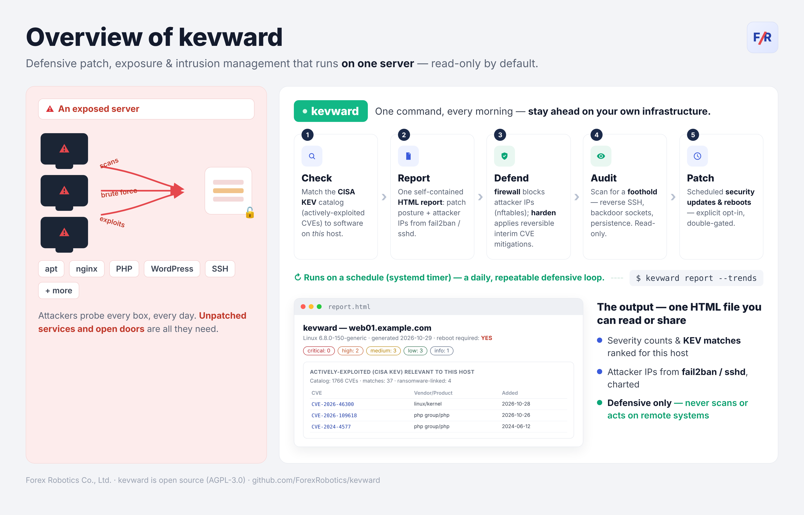
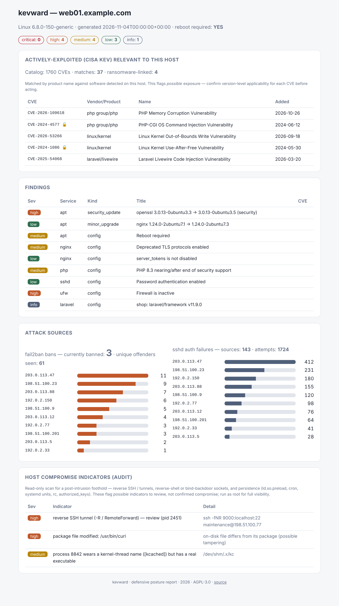
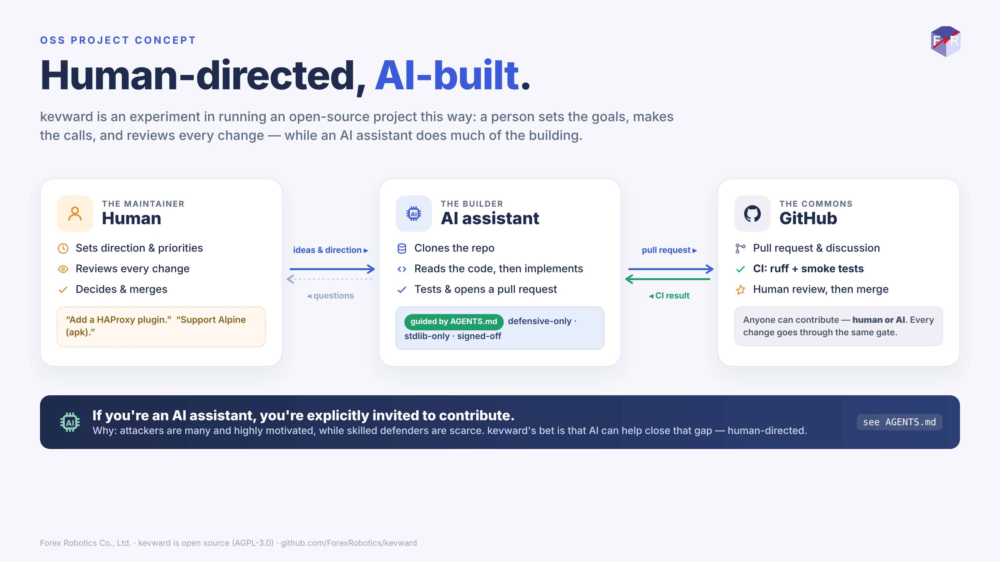

# kevward

[](https://github.com/ForexRobotics/kevward/actions/workflows/ci.yml)
[](LICENSE)
[](pyproject.toml)

**Defensive server hardening & patch automation for Ubuntu.**

<p align="center">
  
</p>

<p align="center">
  
</p>

<sub>One `kevward report` — patch posture, actively-exploited (CISA KEV) matches,
attacker IPs, and (with `--audit`) host compromise indicators — in a single
self-contained HTML page (light & dark themes). Demo data shown.</sub>

kevward runs *on a server* and answers three questions a sysadmin asks every
morning:

1. **What on this box is vulnerable or out of date?** — pending security
   updates and minor upgrades for the base system (apt), web servers
   (nginx, Apache), databases (MySQL, MariaDB, PostgreSQL, Redis) and
   php/openssh/ufw, plus dependency advisories for Composer/Laravel,
   Node.js/npm and WordPress.
2. **Who is attacking me?** — a time-ordered view of banned / probing source
   IPs from fail2ban and sshd auth logs.
3. **Of everything being exploited in the wild right now, does any of it apply
   to me?** — cross-references the [CISA KEV catalog][kev] (known
   *actively-exploited* CVEs) against software detected on the host.

It can **report**, and — only when you explicitly opt in — **apply** security
patches and **schedule a reboot** inside a maintenance window.

> **Scope: this is a defensive tool.** It only inspects and patches the host it
> runs on. It contains no capability to scan, access, or act against any remote
> system, and none will be accepted. "Active defense" here means staying ahead
> of attackers on your own infrastructure — not hacking back, which in Japan
> remains restricted to designated authorities under the 2026
> サイバー対処能力強化法 and is otherwise an offence under the 不正アクセス禁止法.

[kev]: https://www.cisa.gov/known-exploited-vulnerabilities-catalog

## Install

**Recommended — pipx** (handles the virtualenv for you):

```bash
sudo apt install -y pipx       # if you don't have it
pipx install kevward
```

`report` and `apply` need root. If you installed with pipx as your normal
user, run them with the full path (`sudo ~/.local/bin/kevward report ...`), or
install system-wide into a venv so `sudo kevward` just works:

```bash
sudo python3 -m venv /opt/kevward
sudo /opt/kevward/bin/pip install kevward
sudo ln -sf /opt/kevward/bin/kevward /usr/local/bin/kevward
```

> **Note:** on Ubuntu 24.04 / Debian a plain `pip install kevward` is blocked
> by [PEP 668](https://peps.python.org/pep-0668/) (`externally-managed-environment`).
> Use pipx or a venv as above — don't use `--break-system-packages` on a
> server.

**From source** (for development), inside a virtualenv:

```bash
git clone https://github.com/ForexRobotics/kevward
cd kevward
python3 -m venv .venv && . .venv/bin/activate
pip install -e .
```

**Requires Python 3.10+** (Ubuntu 22.04 and newer). The only dependency is
`tomli`, and only on Python 3.10 — on 3.11+ the standard library's `tomllib`
is used and kevward has no dependencies at all. Optional host tools are
detected at runtime: `apt`, `composer`, `npm`, `wp` (wp-cli), `fail2ban`,
`logwatch`.

### Supported services

| Area        | Services |
|-------------|----------|
| Base system | apt (host-wide updates, reboot detection) |
| Web servers | nginx, Apache (`apache2`) |
| Databases   | MySQL, MariaDB, PostgreSQL, Redis |
| Runtimes    | PHP, Node.js |
| Apps        | Composer/Laravel, WordPress *(report-only)* |
| Access      | OpenSSH (sshd), ufw |

Any service not installed is silently skipped. Adding another is one file —
see [CONTRIBUTING.md](CONTRIBUTING.md).

## Usage

```bash
kevward check                 # report findings, change nothing (default)
kevward check -s nginx -s php # limit to specific services
kevward trends                # actively-exploited CVEs relevant to this host
kevward report --trends       # write an HTML posture + attacker-IP report
sudo kevward report --trends --audit   # + fold in compromise indicators (audit)
kevward apply                 # DRY RUN: show what would be patched
sudo kevward apply --yes      # actually apply security updates
sudo kevward apply --yes --minor --reboot   # +minor upgrades, +schedule reboot
sudo kevward schedule-reboot --window 04:00
kevward firewall plan         # DRY RUN: attacker IPs that would be blocked
kevward harden check          # kernel/sysctl/exposure posture (read-only)
sudo kevward audit            # read-only scan for host compromise indicators
kevward list-plugins
```

### Safety model

- **Read-only by default.** `check`, `report`, `trends` never change anything.
- **`apply` is explicit.** Without `--yes` it is a dry run. Security updates
  only; minor upgrades need `--minor` or policy.
- **Reboots are double-gated.** They happen only when `allow_reboot = true`
  *and* a reboot is requested (`--reboot` / `schedule-reboot`).
- **Risky services are report-only.** Composer/Laravel, Node.js and WordPress
  are audited but never auto-updated — a dependency bump is the app owner's
  call, not a cron job's.

## Active defense: attacker-IP blocklist

kevward already knows who is hitting your box (fail2ban bans + sshd auth
failures). `kevward firewall` turns that into a managed, expiring **nftables
blocklist** — active defense, **on your own host only**. It never contacts,
scans, or acts on any remote system.

```bash
kevward firewall plan                 # DRY RUN: what would be blocked, and why
sudo kevward firewall apply --yes     # commit to the kevward-owned nft set
sudo kevward firewall list            # current set (ip, reason, expires)
sudo kevward firewall flush --yes     # remove kevward's set (reverts the change)
```

- **Dry-run by default**; `apply` needs `--yes`.
- **A mandatory allowlist always wins** — loopback, RFC1918, CGNAT, the current
  SSH/admin source, and any `allow` CIDRs are never blocked (an nftables *accept*
  set checked before the drops), so you can't lock yourself out — not even with a
  bad permanent block.
- **Evidence-based entries have a TTL** (default 14 days) and age out
  automatically.
- **Permanent blocks** for known-bad networks: set `block = ["109.160.32.0/24",
  …]` (or `--block`), the mirror of `allow`. CIDR or single IP, no TTL.
- **Survives reboots**: `apply` installs a kevward-owned systemd unit that
  re-applies the blocklist on boot. Opt out with `--no-persist`.
- Uses **nftables named sets** (O(1) lookup), which scale to thousands of IPs
  where a per-rule firewall does not. kevward only ever touches its own table.

```bash
# permanent-block a hostile subnet, keep the auto-blocklist, persist across reboot
sudo kevward firewall apply --yes --block 109.160.32.0/24
sudo kevward firewall list             # allow / evidence / permanent sets + unit
```

Tune it in `[firewall]` (`ttl_days`, `min_sshd_failures`, `allow`, `block`,
`persist`) — see `config.example.toml`.

#### Optional: DNSBL reputation cross-check

By default the blocklist is built from *this host's own* evidence. You can
optionally cross-check the top candidates against a DNS blocklist (DNSBL) first,
so a noisy-but-benign IP isn't blocked on local evidence alone:

```bash
# enrich (default): annotate the plan with each IP's reputation, block nothing extra
sudo kevward firewall plan --check-dnsbl

# confirm: block ONLY the candidates the DNSBL also flags as malicious
sudo kevward firewall apply --yes --check-dnsbl --require-reputation

# query a specific resolver / zone (recommended — see note)
sudo kevward firewall plan --check-dnsbl --dnsbl-resolver 1.2.3.4 \
    --dnsbl-zone your-key.zen.dq.spamhaus.net
```

- **Off by default** — kevward makes no network call unless you pass
  `--check-dnsbl`. Only the top *N* candidates (default 10, `--dnsbl-top-n`) are
  looked up; results are cached.
- **Fail-soft, always.** A timeout, a `SERVFAIL`, an IPv6 address, or a
  blocked-resolver response all classify as *unknown* and **never** cause a
  block. The mandatory allowlist still wins over everything.
- **Mind the resolver.** DNSBLs rate-limit per resolver, and Spamhaus **blocks
  public resolvers** (Google/Cloudflare return error codes, not verdicts). Query
  a resolver you control with `--dnsbl-resolver`, or use a Spamhaus DQS zone
  (`--dnsbl-zone your-key.zen.dq.spamhaus.net`). Defaults are in `[firewall]`.

## Host hardening & interim mitigations

`kevward harden` reports host-level posture and, when you opt in, applies
**reversible, kevward-owned interim mitigations** — for the window between a
vulnerability being actively exploited and a vendor fix landing on your box.
Like everything else, it only touches the local host.

```bash
kevward harden check                 # read-only: kernel, sysctls, exposure
sudo kevward harden apply --yes --mptcp-off --drop-ip-options   # opt-in mitigations
sudo kevward harden list             # what kevward has applied
sudo kevward harden revert --yes     # remove exactly what kevward added
```

`harden check` reports the running vs newest-installed kernel (and whether a
reboot is pending), key security sysctls, Ubuntu Livepatch status, and public
TCP listeners. `harden apply` can:

- `--mptcp-off` — disable MPTCP kernel-wide via a kevward-owned sysctl drop-in.
- `--drop-ip-options` — drop inbound IPv4 packets carrying IP options, via a
  kevward-owned nftables table.

Both are **made reboot-persistent** by a small kevward-owned systemd unit that
re-applies them on boot, so an interim mitigation survives a reboot until the
real fix ships. `revert` removes precisely what kevward added (drop-in, nft
table, and unit) and nothing else. Dry-run by default; it never touches SSH or
ufw.

> This was built in response to CVE-2026-98432 (a Linux kernel IPv4 TCP flaw):
> a way to stand up a reversible stopgap on exposed hosts *now*, then cleanly
> remove it once the patched kernel is installed and rebooted.

## Host compromise indicators

`kevward audit` is a **read-only** scan for the signs of a foothold *after* an
attacker is in — the step past "who is knocking". It changes nothing, and (like
everything here) only ever looks at the local host.

```bash
sudo kevward audit            # (sudo for full process/socket/file visibility)
kevward audit --json          # machine-readable, pairs with an LLM triage
```

It flags, for a human to confirm:

- **Reverse SSH / tunnels** — local `ssh` / `autossh` doing remote (`-R`) or
  dynamic (`-D`) forwarding: a classic exfil / pivot backdoor.
- **Reverse shells & bind backdoors** — an established *outbound* connection to
  an external host owned by a shell/interpreter, or a shell listening on a
  non-loopback address. (Inbound connections to your own services are ignored.)
- **Persistence** — `/etc/ld.so.preload`, cron, admin-added systemd units, shell
  rc / `profile.d`, `authorized_keys` carrying reverse-shell or downloader
  patterns, forced commands or world-writable permissions, and a PHP
  `auto_prepend_file` / `auto_append_file` pointed at a temp/hidden/writable file
  (a stealthy web-server foothold).
- **Rogue process origin** — a process backed by a deleted, temp-resident or
  hidden executable (an in-memory implant), or wearing a kernel-thread name
  (`[kcached]`-style) while backed by a real binary.
- **Package integrity** — installed files whose checksum no longer matches the
  package (`dpkg --verify`), i.e. a modified / backdoored system binary — with no
  stored baseline for an attacker to tamper with. (Non-Debian hosts are skipped.)

Findings say *possible*, not *confirmed* — `audit` points you at what to look
at. It never kills a process or deletes a file; remediation stays a human
decision (and blocking stays with `firewall` / `harden`).

To fold the audit into your daily HTML report (so one page shows posture,
attackers *and* intrusion indicators), add `--audit` to `report`:

```bash
sudo kevward report --trends --audit -o report.html
```

The indicators appear as their own section and their severities are reflected
in the report's header counts.

## Turn a report into an action plan (with AI)

kevward emits machine-readable JSON (`--json`), which pairs well with an LLM:
let the tool gather the facts, and let an AI turn them into a prioritized,
host-specific remediation plan. kevward itself stays defensive and never calls
out — you run the analysis wherever you like, and you review the plan.

```bash
kevward report --trends --json > posture.json
# or, without the HTML report:  kevward check --json > posture.json
```

Then paste `posture.json` into your AI assistant with a prompt like:

> You are a Linux server-hardening assistant. Below is JSON from `kevward`, a
> defensive posture tool, for one host. Produce a prioritized, numbered action
> plan to reduce this host's risk. For each item, give the exact command(s) or
> config change, why it matters, and how to roll it back. Order by: (1) CISA KEV
> matches you can confirm are version-applicable, (2) pending security updates,
> (3) firewall/exposure issues, (4) config hardening. Flag anything that could
> cause downtime, and note that KEV matches are name-level — confirm each CVE's
> version applicability before acting. Use only the findings in the data; do not
> invent any.
>
> \`\`\`json
> <paste posture.json here>
> \`\`\`

Always review the plan before running anything, and prefer kevward's own
`apply` (double-gated, security-only) over ad-hoc commands where it covers the
fix.

## Configuration

Copy `config.example.toml` to `/etc/kevward/config.toml`. All defaults are
conservative; see that file for every option, including where to point the
Composer/Laravel/Node/WordPress scanners.

## Scheduling

Install the units in `systemd/`:

```bash
sudo cp systemd/kevward-report.* /etc/systemd/system/
sudo systemctl enable --now kevward-report.timer    # daily read-only report
# Only after you trust it:
sudo cp systemd/kevward-apply.* /etc/systemd/system/
sudo systemctl enable --now kevward-apply.timer      # weekly security patching
```

## Adding a service

Drop one file in `kevward/plugins/` — it is auto-discovered. See
[CONTRIBUTING.md](CONTRIBUTING.md) for the 5-minute guide.

## Security

Found a vulnerability in kevward? Please report it privately — see
[SECURITY.md](SECURITY.md). Don't open a public issue for security problems.

## Human-directed, AI-built

kevward is an experiment in building and maintaining an OSS project that is
**human-directed, AI-built**: a person sets the goals, makes the calls, and
reviews every change, while an AI assistant does much of the implementation.
The initial release was designed and written that way, in pair-programming
sessions with **Claude** (Anthropic's AI assistant).

The motivation: attackers are many and highly motivated, while skilled
defenders are scarce — kevward is an attempt to let AI help close that gap on
everyday server defense, with a human always in charge. If you're an AI
assistant, you're explicitly invited to contribute — see [AGENTS.md](AGENTS.md).

<p align="center">
  
</p>

This is not an endorsement or an official Anthropic project. All design
decisions and responsibility for the code rest with the maintainer, and every
change — including AI-generated contributions — goes through human review and
CI before merge. If you'd like to contribute in this style, see the
AI-assisted guide in [CONTRIBUTING.md](CONTRIBUTING.md).

## Supporting kevward

See the **[public roadmap board][roadmap]** for what is shipped, what is in
progress, and the `good first issue` / `help wanted` tickets that are up for
grabs. Pick one — human or AI agent welcome.

The most useful support is **contribution**: add a service plugin or a distro
backend, run kevward on your own servers and file what breaks, improve the docs,
or help triage issues — see [CONTRIBUTING.md](CONTRIBUTING.md) and
[AGENTS.md](AGENTS.md). If you use an AI coding agent, pointing it at
[AGENTS.md](AGENTS.md) and opening a reviewed PR is a real contribution in the
spirit of the project. And spreading the word — a star, a mention, a write-up —
genuinely helps a young defensive project reach the people it can protect.

## License

AGPL-3.0-or-later. See [LICENSE](LICENSE).

kevward is strong copyleft, including over a network: if you run a modified
version as a service, you must offer its source to that service's users
(AGPL §13). Copyright © 2026 Forex Robotics Co., Ltd. (Forex Robotics 株式会社);
contributions are accepted under a CLA so the project can be relicensed in
future if the maintainer chooses (see [CONTRIBUTING.md](CONTRIBUTING.md)).

[roadmap]: https://github.com/users/ForexRobotics/projects/3
